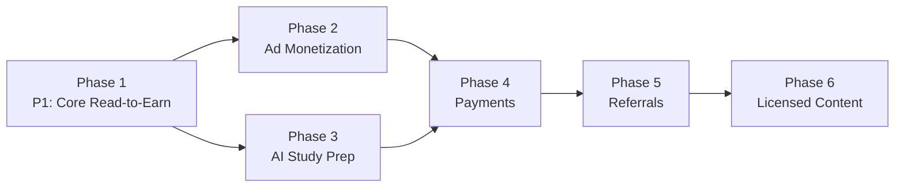

# PagePay: Complete Product Roadmap & System Architecture
*Last updated: October 20, 2026*

> **Read this first — everything below the "Original Plan" line was written in June 2026.**
>
> The AI provider, database, payments and ad sections describe an
> architecture the project has since left. The **current** architecture:
>
> | Area | Was (below) | Is now |
> |---|---|---|
> | Database | MySQL 8.0 | **PostgreSQL 18** (Neon in production, Render-hosted API) |
> | AI provider | Gemini → Groq → Cerebras → OpenRouter | **Cloudflare Workers AI only**, no failover |
> | AI models | Gemini 2.5 Flash, Llama 3.3 70B | **Granite 4.0 H-Micro** (standard), **GLM-4.7-Flash** (premium), **Llama-3.2-11B-Vision** (OCR), **MeloTTS** (narration) |
> | Payments | Flutterwave v4 primary, Paystack fallback | **Paystack only** (Flutterwave config fields are inert) |
> | Ads | AdMob + AppLovin MAX together | **AdMob only** (AppLovin config fields are inert) |
> | Premium tier | 3 tiers (Free / Study+ / Complete+) | **One paid plan: ₦3,000/mo or ₦30,000/yr** |
> | Bills | — | Peyflex **or** BigiSub, selected by `settings.bills_provider` |
>
> The authoritative current documents are `.kilo/steering.md`,
> `PRICING_AND_UNIT_ECONOMICS.md`, `admob.md` and `.kilo/agent/*.md`.
> Where this file and the code disagree, the code wins — verify before
> implementing.

---

## Current Status

| Phase | Name | Status |
|---|---|---|
| 1 | Read-to-Earn Core | Shipped |
| 2 | Ad Monetization Foundation | Shipped (backend SSV live; **client pipeline outstanding**) |
| 3 | Student AI Exam Prep | Shipped |
| 4 | Payments & Premium Tier | Shipped (Paystack; tier since collapsed to one plan) |
| 5 | Referrals & Community | Shipped |
| 6 | Licensed Content & Scale | Shipped in part — content provider abstraction done; **Redis/CDN/analytics still open** |
| 7 | Task Marketplace | Shipped |
| 8 | Bills & VTU | Shipped |
| 9 | Monetization Hardening | In progress |

### What Phase 9 still owes

1. **The AdMob client pipeline.** The backend SSV endpoint
   (`GET /api/v1/study/ads/complete`) is live and verified. The app has
   **no ad code at all** — no config plugin in `app.config.js` (without it
   the native SDK crashes on launch), no `mobileAds()` init, no ad
   components, no call sites. Until this ships there are no impressions,
   and ads are the leg that funds the free tier.
2. **Upload and exam quotas.** Chat is metered (5/day free, 15/day paid
   tier, 50 billable/day). Uploads (₦2.60–₦3.58 each) and exams (₦1.35
   each) are unbounded.
3. **A routing eval set.** The Standard/Premium split sends simple
   student questions to Granite, and there is no labelled set measuring
   whether it answers them correctly.

---

## Original Plan (as planned in June 2026)

## Design Philosophy
Ship every phase as a standalone, monetizing product. Each phase is an MVP, not a milestone to hide until completion.

---

## Phase 1: Read-to-Earn Core (Weeks 1–3)

**Goal:** Launch a functional read-to-earn mobile app on Play Store using free content.

### User Value
- Students and casual readers can read public domain books/news
- Earn confirmable points for verified slice completion
- Points tracked live in a wallet

### Backend Build
- **FastAPI project init** with Python 3.11+
- **PostgreSQL 18** database with async driver (`asyncpg` + SQLAlchemy 2.0 async) — *as planned in June 2026 this said MySQL 8.0; the project moved to PostgreSQL before implementation*
  - Tables: `users`, `reading_sessions`, `content_catalog`, `ad_events`
- **JWT authentication** (email/phone + OTP or password)
- **Reading tracker API:**
  - `POST /api/v1/session/start` → starts timer, logs content_id
  - `POST /api/v1/session/heartbeat` → client pings every 10s, server validates scroll_velocity + foreground state
  - `POST /api/v1/session/end` → calculates points, commits to wallet
- **Admin endpoint:** bulk-import content from Gutendex/GNews
- **Deploy:** Docker container on Render.app (FastAPI + managed PostgreSQL on Neon) — *as planned in June 2026 this said Railway; the project deployed to Render*

### Frontend Build (Expo SDK 55 — New Architecture mandatory)
- **Required SDK:** Expo SDK 55+ (React Native 0.83, React 19.2, New Architecture mandatory)
- **State management standard 2026:**
  - TanStack Query v5 for server state (feed, wallet)
  - Zustand for client state (theme, current book)
  - MMKV for persistent storage (auth tokens, preferences)
- **Navigation:** Expo Router (file-based routing in `app/` directory)
- **Folder architecture:** Feature-based (not file-type-based)

```
app/
  (auth)/
    login.tsx
    register.tsx
  (tabs)/
    _layout.tsx
    index.tsx          ← Home / Feed
    catalog.tsx        ← Book browser
    study.tsx          ← Phase 3
    wallet.tsx
  reader/
    [id].tsx           ← Dynamic: /reader/42
src/
  features/
    auth/
    catalog/
    reader/
    wallet/
    study/
  shared/
    api/
    components/
    hooks/
    utils/
```

- **Catalog tab:**
  - FlatList of book cards (title, cover placeholder, category, estimated earn)
  - Filter chips: Fiction | Non-Fiction | News | Classics
- **Reader screen:**
  - Clean scrollable text view
  - Floating progress indicator
  - Timer pill showing countdown to earning threshold
- **Wallet tab:**
  - Current balance display
  - Transaction history
  - "Withdraw" placeholder
- **Anti-cheat logic (client):**
  - `AppState` listener + `AppState.addEventListener('change', ...)`
  - `react-native-reanimated` scroll event on `FlashList` / `FlatList`
  - Timer pauses if scroll distance < 100px per 30s
  - Random "Read Check" modal every 5 articles

### Shippable Feature Set (Phase 1)
✅ User registration & login
✅ Browse and read public domain books + news
✅ Earn points for verified slice completion
✅ Wallet balance tracking
✅ In-app anti-bot guardrails
✅ Live on Play Store as "PagePay: Read & Earn"

---

## Phase 2: Ad Monetization Foundation (Weeks 4–6)

**Goal:** Attach real revenue to every user interaction.

### Backend Build
- **Ad network scaffolding:**
  - `ad_placements` table (id, location, ad_type, priority, primary_provider, fallback_provider)
  - `ad_impressions` table (id, user_id, session_id, ad_type, ad_unit, provider, impression_revenue, timestamp)
  - **As shipped: AdMob only.** The `provider`/`fallback_provider` columns remain so a second network can be added later, but AppLovin is not integrated — `applovin_sdk_key` and `applovin_webhook_secret` are inert config fields.
  - **Why dual networks was the plan:** AdMob gives the best global fill rate (especially Android); AppLovin MAX gives the best rewarded-video eCPMs. Running both prevents single-network rate limiting, account review holds, or fill drops that can kill daily revenue. **This has not been done.**
- **Server-Side Verification (SSV) endpoints:**
  - Webhook `GET /api/v1/study/ads/complete` (AdMob — AdMob uses GET in practice). *As planned in June 2026 this said `POST /api/v1/ads/google/callback`.*
  - Idempotency via AdMob's `transaction_id`
  - AppLovin's webhook was planned but never built.
  - Verification: ECDSA P-256 against AdMob's rotating public keys, plus a reverse-DNS check that the caller is a Google domain.
- **Native Ad feed generation:**
  - `GET /api/v1/content/feed/:user_id` → injects sponsored content slots every 4 articles
  - Sponsored entries flagged `is_sponsored: true`
- **Reward multiplier logic:**
  - Base rate: a flat slice bonus (2 pts) × the user's tier multiplier (1.0x free, 1.5x paid) — *as planned in June 2026 this hardcoded "2 pts Free / 4 pts Premium"*
  - SSV confirms a full watch → the server credits the user. Ad reward is a flat **16 SV** for free and paid alike — no tier multiplier, deliberately.

### Frontend Build
**CRITICAL 2026 NOTE:** Expo Go does NOT ship AdMob adapters. You MUST build a **Development Build** (`expo-dev-client`) with real native code to run AdMob in Expo SDK 57.

> **Status: the client pipeline was never built.** `react-native-google-mobile-ads` 15.8.0 is in `package.json`, but the config plugin is absent from `app.config.js` (without the App IDs the native SDK crashes on launch), there is no `mobileAds()` init, and there are no ad components or call sites. The backend SSV endpoint is live and waiting. See `admob.md` §9 for the rollout checklist and `.kilo/agent/frontend.md` §6.

- Use `expo-dev-client` + `react-native-google-mobile-ads` (AdMob)
- **Single network:** AdMob only for now. AppLovin MAX was to be the secondary; it is not integrated.
- Use **Native Advanced (Custom) Ads** via AdMob styled to match app typography
- **Interstitial Ads:** at natural breakpoints only — after finishing an exam, leaving the reader, returning to a tab root. Never mid-exam, never mid-lesson, never on app open (AdMob policy prohibits it).
- **Rewarded Video Ads:** user-initiated, opt-in — the payment chooser's "Watch ad" option on asset + audio unlocks
- Initialize the SDK on app startup so ad assets cache aggressively

### Shippable Feature Set (Phase 2)
✅ Native in-feed banner ads
✅ Rewarded video with server-side verification
✅ Interstitial ads on navigation
✅ Real ad revenue tracking
✅ Double-earn mechanic
✅ Play Store update: "PagePay: Read, Watch & Earn"

---

## Phase 3: Student AI Exam Prep (Weeks 7–10)

**Goal:** Attach high-retention student vertical to reduce churn and increase ad inventory per user.

### Backend Build
- **AI Provider Router (`app/ai/router.py`):**
  - Single provider: **Cloudflare Workers AI**. No failover, no circuit breaker — a Cloudflare outage is a 503 on every AI feature.
  - Two text models selected by tier: `ai_standard_model` (Granite 4.0 H-Micro) and `ai_premium_model` (GLM-4.7-Flash), with `app/ai/routing.py::classify_turn()` picking between them for chat
  - Vision (OCR): `@cf/meta/llama-3.2-11b-vision-instruct`
- **Study asset generation endpoints:**
  - `POST /api/v1/study/sow/upload` → accepts image or text
    - If image: OCR via the Cloudflare vision model
    - If PDF: rendered page by page with PyMuPDF, then OCR'd the same way — the PDF's embedded text layer is not used, because a scan or a photo has none
    - Parsed on the premium model — a misparsed syllabus is not worth saving a fraction on
  - `POST /api/v1/study/generate` → generates MCQ + flashcard + essay JSON
    - Premium model
  - `POST /api/v1/study/chat` → streaming Q&A on uploaded material
    - FastAPI `StreamingResponse` with generator for token-by-token delivery
    - Quota-enforced: 5/day free, 15/day paid tier, then purchasable with SV
- **Tables:**
  - `study_materials` (id, user_id, raw_input, parsed_structure, ai_model_used, created_at)
  - `quiz_sessions` (id, user_id, material_id, score, points_earned, questions, user_answers)
  - `payments` (id, user_id, amount_ngn, paystack_tx_ref, status, created_at, webhook_confirmed)

### AI Provider Assignment (as shipped)

| Task | Model | Why |
|------|-------|-----|
| SOW/syllabus upload (parse) | Premium — `@cf/zai-org/glm-4.7-flash` | A misparsed syllabus is expensive to get wrong |
| MCQ / flashcard / essay generation | Premium — GLM-4.7-Flash | A wrong answer key is worse than no material |
| Chat / Q&A | Classified: Granite → GLM | Definitions and recall go to the cheap model; reasoning escalates |
| Image + PDF page OCR | `@cf/meta/llama-3.2-11b-vision-instruct` | Separate capability, not a text tier |
| Narration | GLM-4.7-Flash + MeloTTS | Script quality is user-visible |
| Circuit breaker | **None** | Single provider — the quota and rate limits are what protect us |

### Frontend Build
- **New "Study" tab** in bottom navigation (Expo Router)
- **SOW Upload UI:**
  - `expo-image-picker` for camera / gallery
  - `expo-document-picker` for PDF/text files
  - Loading state with `@shopify/react-native-skia` progress ring
- **Asset Browser:**
  - Accordion: MCQs | Flashcards | Essay Questions
  - MCQ: touchable single-choice buttons, instant feedback
  - Flashcard: `react-native-reanimated` tap-to-flip
  - Essay: typebox with AI-generated outline
- **Ad-gated answers:**
  - "Answer locked — watch 15s video to reveal"
  - "50 pts to unlock — Watch video free"
- **Points multiplier for study:**
  - Score ≥ 80%: bonus 20 pts
  - Completes study session → eligible for daily streak bonus

### Shippable Feature Set (Phase 3)
✅ SOW/scheme upload → AI structured outline
✅ Auto-generated MCQs, flashcards, essays
✅ Answer-gate via rewarded ads or points
✅ Streaming study chat (Q&A on material)
✅ Points for quiz performance
✅ Play Store update: "PagePay: Read, Study & Earn"

---

## Phase 4: Payments & Premium Tier (Weeks 11–13)

**Goal:** Diversify revenue beyond ads with direct user payments.

### Backend Build
- **Paystack integration** — *as planned in June 2026 this said Flutterwave v4 primary with Paystack as fallback. The project went the other way: Paystack is the only live provider and the Flutterwave config fields are inert.*
  - `POST /api/v1/payments/initiate` → returns payment URL
  - Webhook `POST /api/v1/payments/paystack/webhook` → confirms, updates tier. Paystack signs with the **secret key** — there is no separate webhook secret.
  - Idempotent: store the transaction reference and verify no duplicate credits
  - Paystack also handles wallet deposits and payouts (transfers), with a flat-fee schedule mirrored in config
- **Subscription logic:**
  - `tier`: the shipped enum still carries `free | study_plus_monthly | study_plus_yearly | complete_plus_monthly | complete_plus_yearly`, but **all four paid keys resolve to one plan** — ₦3,000/mo or ₦30,000/yr. The old Study+ ₦1,000 / Complete+ ₦2,000 prices are gone.
  - `subscription_expires_at` → cron job reverts to free tier when expired
  - Prevents over-provisioning
- **Tier-based config:**
  - Prices, durations and multipliers live in `backend/app/tier_benefits.json` for OTA price changes
  - What ₦3,000 buys: free asset unlocks, free audio narration, 15 chat turns/day, 1.5x reading/task/bills/daily multipliers, a 2,500 SV monthly allowance and a 30% top-up discount

### Frontend Build
- **Paywall screens:**
  - "Free (watch ads)" vs the single paid plan
  - One-tap Paystack checkout (card, transfer, USSD) — *as planned in June 2026 this said Flutterwave and "₦500 / month"*
  - `expo-web-browser` for hosted payment page
  - Success state: instant premium unlock
- **Premium indicators:**
  - Gold badge on profile
  - Ad-free premium experience
  - 1.5x reading points
- **Billing history:** list of payments with dates

### Shippable Feature Set (Phase 4)
✅ One-tap Paystack checkout
✅ Monthly premium subscription (₦3,000/mo or ₦30,000/yr)
✅ Ad-free premium experience for students
✅ Billing history
✅ Play Store update: "PagePay: Read, Study, Learn & Earn"

---

## Phase 5: Referrals & Community (Weeks 14–18)

**Goal:** Network effects to reduce CAC and increase retention.

### Backend Build
- **Referral system:**
  - `POST /api/v1/referral/generate` → unique referral code
  - `GET /api/v1/referral/stats`
  - Both referrer and referee get bonus on first verified session
  - Server validates referee completed reading session before awarding referrer
- **Content library expansion:**
  - Cron sync Hive blockchain posts hourly
  - Add RSS feeds for tech, sports, politics
  - Pre-approve Taboola/Outbrain application during this phase
- **Admin dashboard:** cohort retention, top content, AI cost per user

### Frontend Build
- **Referral share sheet:** `expo-sharing` with pre-filled WhatsApp/X message
- **Community section:** browse notes uploaded by other students
- **Advanced catalog:** continue reading carousel, basic recommendations
- **Reading streak counter**

### Shippable Feature Set (Phase 5)
✅ Referral rewards program
✅ Community study notes feed
✅ Advanced book discovery
✅ Baseline analytics
✅ Play Store update: "PagePay: Learn, Read, Refer & Earn"

---

## Phase 6: Licensed Content & Scale (Weeks 19+)

**Goal:** Replace placeholder content with licensed/syndicated material.

### Backend Build
- **Content provider abstraction:**
  - Unified interface: `get_article(id)`, `search(query)`, `get_feed(category, page)`
  - Implement adapters for: Taboola, GNews, NewsBreak, Hive
  - Feature flags `content_sources` table to toggle without deploy
- **Revenue-share reconciliation:** daily import of partner earnings

### Frontend Build
- **Taboola native widget** within reader
- **"Sponsored Reading"** section with clear labeling
- **Region auto-detection** via `expo-localization`

### Shippable Feature Set (Phase 6)
✅ Licensed news integration (Taboola/Outbrain)
✅ Sponsored content feed
✅ Revenue-share reconciliation
✅ Regional content variants
✅ "PagePay: Global Read-to-Earn Platform"

---

## System Architecture

```
┌─────────────────────────────────────────────────────────────────────┐
│                         CLIENT TIER                                 │
│  ┌───────────────────────────────────────────────────────────────┐ │
│  │              Expo SDK 55 (New Architecture)                  │ │
│  │  expo-router  │  expo-dev-client  │  expo-updates (OTA)     │ │
│  │  TanStack Query v5  │  Zustand  │  MMKV                     │ │
│  └──────────────────────────────────────────────────────────────┘ │
│                            │ HTTPS                                  │
└────────────────────────────┼───────────────────────────────────────┘
                             │
┌────────────────────────────▼───────────────────────────────────────┐
│                    FASTAPI BACKEND (Docker)                         │
│  ┌──────────────────────────────────────────────────────────────┐  │
│ │  AI ROUTER (route_ai — a Python function, not an endpoint)    │  │
│ │  standard: Granite 4.0 H-Micro │ premium: GLM-4.7-Flash       │  │
│ │  vision: Llama-3.2-11B-Vision  │ tts: MeloTTS                │  │
│  └──────────────────────────────────────────────────────────────┘  │
│  ┌──────────────────────────────────────────────────────────────┐  │
│ │  READING ENGINE  │  AD SSV VERIFIER  │  REFERRAL ENGINE       │  │
│  └──────────────────────────┬───────────────────────────────────┘  │
│                             │                                       │
│  ┌──────────────────────────▼───────────────────────────────────┐  │
│ │  PostgreSQL 18 (asyncpg + SQLAlchemy 2.0 async)              │  │
│ │  users │ wallets │ sessions │ ad_events │ study_materials    │  │
│ │  quiz_history │ payments │ referrals │ content_catalog       │  │
│  └──────────────────────────────────────────────────────────────┘  │
└──────────────────────────────────────────────────────────────────┘
                              │
               ┌───────────────┼───────────────┐
               ▼               ▼               ▼
      ┌─────────────────┐ ┌───────────┐ ┌──────────────────┐
       │ CONTENT FEEDS   │ │ AI PROVIDER│ │ AD NETWORK         │
       │ • Gutendex      │ │ • Cloudflare│ │ • Google AdMob    │
       │   (public domain)│ │   Workers AI│ │   (only network)  │
       │ • GNews (free)  │ │   (single) │ │                    │
       │ • OpenStax (OER)│ │            │ │                    │
       │ • RSS           │ │            │ │                    │
      └─────────────────┘ └───────────┘ └──────────────────┘
                              │
                     ┌─────────▼─────────┐
                     │ PAYMENT GATEWAY   │
                     │ • Paystack        │
                     │   (only provider) │
                     └───────────────────┘
```

---

## AI Router Logic (as shipped)

There is no provider list and no failover. The whole client is `app/ai/router.py`:

```python
# backend/app/ai/router.py
from app.ai.routing import PREMIUM, STANDARD

def resolve_model(model_tier: str | None = None) -> str:
    """Map a tier to a model id.

    An unknown or missing tier resolves to premium. That is deliberate:
    a cheap wrong answer costs a student more than a saved fraction.
    """
    if model_tier == STANDARD:
        return settings.ai_standard_model      # Granite 4.0 H-Micro
    return settings.ai_premium_model            # GLM-4.7-Flash

async def route_ai(prompt, task_type="heavy", model_tier=None, db=None):
    model = resolve_model(model_tier)
    # POST https://api.cloudflare.com/client/v4/accounts/{id}/ai/run/{model}
    # Cloudflare returns the text in `result.response` — NOT in
    # result.choices[0].message.content (that is the OpenAI-compatible shape).
    ...
    return {"response", "provider", "model", "usage", "latency_ms", "cost_usd"}
```

For chat turns, `app/ai/routing.py::classify_turn()` picks the tier from the
question. `settings.ai_routing_enabled = False` forces everything to premium
while validating the split.

**Cost control is the quota, not the failover.** Free chat is 5/day
(`study_chat_daily_limit`), paid tier 15/day, then 50 billable turns/day
bought with SV at 15 SV (standard) / 35 SV (premium). `services/ai_usage.py`
enforces it; `services/ai_cost.py` and `AiUsageLog.cost_usd` make it
measurable.

---

## Database Schema (SQLAlchemy 2.0 async models)

> The models below are the **June 2026 design sketch**. The live schema is
> `backend/app/models/__init__.py` — it is the single source of truth and
> has grown well past this (study assets, exams, tasks, sponsors, community
> notes, wallets, notifications, fraud, admin RBAC). Note that the tier
> enum sketched here is also out of date: the shipped `UserTier` still
> carries four paid keys (`study_plus_monthly`, `study_plus_yearly`,
> `complete_plus_monthly`, `complete_plus_yearly`) that all resolve to the
> same single ₦3,000 plan, because renaming the enum is a data migration
> and an unknown key falls back to the *free* tier.

```python
from sqlalchemy.orm import DeclarativeBase, Mapped, mapped_column
from sqlalchemy import String, Integer, BigInteger, Boolean, Text, DateTime, Enum
from datetime import datetime
import enum

class Base(DeclarativeBase):
    pass

class UserTier(enum.Enum):
    FREE = "free"
    PREMIUM_MONTHLY = "premium_monthly"
    PREMIUM_YEARLY = "premium_yearly"

class User(Base):
    __tablename__ = "users"
    id: Mapped[int] = mapped_column(BigInteger, primary_key=True, index=True)
    email: Mapped[str | None] = mapped_column(String(255), unique=True, index=True)
    phone: Mapped[str | None] = mapped_column(String(20), unique=True, index=True)
    password_hash: Mapped[str | None] = mapped_column(String(255))
    points_balance: Mapped[int] = mapped_column(BigInteger, default=0)
    tier: Mapped[UserTier] = mapped_column(Enum(UserTier), default=UserTier.FREE)
    referral_code: Mapped[str | None] = mapped_column(String(12), unique=True)
    referred_by: Mapped[str | None] = mapped_column(String(12), index=True)
    subscription_expires_at: Mapped[datetime | None] = mapped_column(DateTime, nullable=True)
    created_at: Mapped[datetime] = mapped_column(DateTime, default=datetime.utcnow)
    last_active_at: Mapped[datetime | None] = mapped_column(DateTime, nullable=True)

class ReadingSession(Base):
    __tablename__ = "reading_sessions"
    id: Mapped[int] = mapped_column(BigInteger, primary_key=True, index=True)
    user_id: Mapped[int] = mapped_column(BigInteger, index=True)
    content_id: Mapped[int] = mapped_column(BigInteger, index=True)
    start_time: Mapped[datetime] = mapped_column(DateTime, default=datetime.utcnow)
    end_time: Mapped[datetime | None] = mapped_column(DateTime, nullable=True)
    duration_seconds: Mapped[int] = mapped_column(BigInteger, default=0)
    points_earned: Mapped[int] = mapped_column(BigInteger, default=0)
    verified: Mapped[bool] = mapped_column(Boolean, default=False)
    scroll_events: Mapped[int] = mapped_column(BigInteger, default=0)

class ContentCatalog(Base):
    __tablename__ = "content_catalog"
    id: Mapped[int] = mapped_column(BigInteger, primary_key=True, index=True)
    title: Mapped[str] = mapped_column(String(500))
    content_type: Mapped[str] = mapped_column(String(50))  # book, article, news
    category: Mapped[str] = mapped_column(String(100), index=True)
    source_url: Mapped[str | None] = mapped_column(String(500))
    body_text: Mapped[str | None] = mapped_column(Text)
    author: Mapped[str | None] = mapped_column(String(255))
    cover_image_url: Mapped[str | None] = mapped_column(String(500))
    estimated_read_minutes: Mapped[int] = mapped_column(Integer, default=5)
    is_sponsored: Mapped[bool] = mapped_column(Boolean, default=False)
    created_at: Mapped[datetime] = mapped_column(DateTime, default=datetime.utcnow)

class AdEvent(Base):
    __tablename__ = "ad_events"
    id: Mapped[int] = mapped_column(BigInteger, primary_key=True, index=True)
    user_id: Mapped[int] = mapped_column(BigInteger, index=True)
    session_id: Mapped[int | None] = mapped_column(BigInteger, nullable=True)
    ad_type: Mapped[str] = mapped_column(String(50))  # rewarded, interstitial, native
    ad_unit: Mapped[str] = mapped_column(String(100))
    provider: Mapped[str] = mapped_column(String(50))  # admob, applovin
    impression_revenue_usd: Mapped[float | None] = mapped_column(BigInteger, nullable=True)
    watched_fully: Mapped[bool] = mapped_column(Boolean, default=False)
    reward_granted: Mapped[bool] = mapped_column(Boolean, default=False)
    transaction_id: Mapped[str | None] = mapped_column(String(255), unique=True, nullable=True)
    created_at: Mapped[datetime] = mapped_column(DateTime, default=datetime.utcnow)

class StudyMaterial(Base):
    __tablename__ = "study_materials"
    id: Mapped[int] = mapped_column(BigInteger, primary_key=True, index=True)
    user_id: Mapped[int] = mapped_column(BigInteger, index=True)
    raw_input: Mapped[str] = mapped_column(Text)
    parsed_structure: Mapped[str | None] = mapped_column(Text, nullable=True)
    ai_model_used: Mapped[str | None] = mapped_column(String(100), nullable=True)
    created_at: Mapped[datetime] = mapped_column(DateTime, default=datetime.utcnow)

class QuizSession(Base):
    __tablename__ = "quiz_sessions"
    id: Mapped[int] = mapped_column(BigInteger, primary_key=True, index=True)
    user_id: Mapped[int] = mapped_column(BigInteger, index=True)
    material_id: Mapped[int | None] = mapped_column(BigInteger, nullable=True)
    score: Mapped[int | None] = mapped_column(Integer, nullable=True)
    points_earned: Mapped[int] = mapped_column(BigInteger, default=0)
    questions: Mapped[str | None] = mapped_column(Text, nullable=True)
    user_answers: Mapped[str | None] = mapped_column(Text, nullable=True)
    created_at: Mapped[datetime] = mapped_column(DateTime, default=datetime.utcnow)

class Payment(Base):
    __tablename__ = "payments"
    id: Mapped[int] = mapped_column(BigInteger, primary_key=True, index=True)
    user_id: Mapped[int] = mapped_column(BigInteger, index=True)
    amount_kobo: Mapped[int] = mapped_column(BigInteger)  # NGN in kobo (₦500 = 50000)
    paystack_tx_ref: Mapped[str | None] = mapped_column(String(255), unique=True, nullable=True)
    provider: Mapped[str] = mapped_column(String(50))  # paystack (the only live provider)
    status: Mapped[str] = mapped_column(String(50), default="pending")  # pending, success, failed
    tier_granted: Mapped[str | None] = mapped_column(String(50), nullable=True)
    webhook_confirmed: Mapped[bool] = mapped_column(Boolean, default=False)
    created_at: Mapped[datetime] = mapped_column(DateTime, default=datetime.utcnow)

# FastAPI lifespan (SQLAlchemy 2.0 async pattern)
from contextlib import asynccontextmanager

@asynccontextmanager
async def lifespan(app: FastAPI):
    async with engine.begin() as conn:
        await conn.run_sync(Base.metadata.create_all)
    yield
```

---

## Phase Dependency Map



---

## Risk Controls Per Phase

| Phase | Primary Risk | Mitigation |
|-------|-------------|------------|
| 1 | Zero content depth | Start with 50 curated public domain chapters + 200 GNews articles |
| 2 | Single ad network fill/eCPM drop or account ban | Implement client-side scroll validation + server heartbeat checks BEFORE SSV; test with test ads 2 weeks. **Dual-network redundancy is still the stated mitigation and is not implemented — AdMob is the only network.** |
| 3 | AI hallucination in study material | Add "Report wrong answer" button; per-session disclaimer "AI-generated, verify with textbook" |
| 4 | Payment gateway stress | Use the Paystack sandbox; test webhook idempotency thoroughly |
| 5 | Referral abuse | Cap daily referral bonuses; server validates referee completed 5-min verified reading session |
| 6 | Content licensing costs | Negotiate Taboola first (no upfront cost); defer NewsBreak until proven DAU |
| 9 | AI cost outruns revenue | Standard/Premium model routing, per-user cost logging, metered chat, upload/exam quotas (**quotas still missing**) |
| 9 | Ads do not fund the free tier | Build the AdMob client pipeline; keep the ad payout at 16 SV flat and the credit in `service_credit_balance` |

---

## Content Provider Status

| Provider | Auth Required | Free Quota | Revenue Share | Launch Ready | Shipped |
|----------|--------------|------------|---------------|--------------|---------|
| **Gutendex / Gutenberg** | No | Unlimited | Yes (commercial reuse, keep PG license) | **Yes — Day 1** | ✅ |
| **GNews** | API key | 100 req/day free | No (your AdMob owns monetization) | **Yes — Day 1** | ✅ `services/content/gnews.py` |
| **OpenStax (OER textbooks)** | No | Unlimited | Yes (CC-licensed) | Yes | ✅ `services/content/openstax.py` |
| **NewsAPI.org** | API key | 100 req/day dev | No | **Yes — Day 1** | ❌ not integrated |
| **Hive Blockchain** | No | Unlimited | Yes (curation rewards) | **Yes — but Web3 complexity** | ❌ not integrated |
| **Taboola/Outbrain** | Yes | N/A | Yes (revenue share) | **No — requires live DAU proof** | ❌ not integrated |
| **Wattpad Enterprise** | Yes | N/A | Yes (revenue share) | **No — B2B contract, not self-serve** | ❌ not integrated |
| **NewsBreak** | Yes | N/A | Yes (revenue share) | **No — selective approval, needs traffic** | ❌ not integrated |

---

## AI Provider Status (as shipped — October 2026)

The free multi-provider pool is **gone**. It was removed in commit `cd01eff`.
There is one provider and no failover.

| Model | Role | List price (USD/M) | Free tier | Commercial use |
|---|---|---|---|---|
| **`@cf/ibm-granite/granite-4.0-h-micro`** | Standard text | $0.017 in / $0.112 out | 10,000 neurons/day | Yes |
| **`@cf/zai-org/glm-4.7-flash`** | Premium text | $0.060 in / $0.400 out | 10,000 neurons/day | Yes |
| **`@cf/meta/llama-3.2-11b-vision-instruct`** | Vision / OCR | $0.049 in / $0.676 out | 10,000 neurons/day | Yes |
| **`@cf/myshell-ai/melotts`** | TTS | $0.0002 / audio-min | included | Yes |

**Decision for PagePay:**
1. Single provider: **Cloudflare Workers AI** — no failover, no circuit breaker.
2. **Standard/Premium split** rather than a provider list: `classify_turn()`
   sends definitions and recall to Granite (₦0.68/turn) and escalates
   reasoning to GLM-4.7-Flash (₦2.43/turn). That is a 3.6x cost cut on any
   turn the cheap model can answer correctly.
3. **The cost control is the quota.** Free chat 5/day, paid tier 15/day,
   then SV-purchased turns capped at 50/day. Uploads and exams are still
   unmetered — that is an open gap.
4. **Per-user cost logging** (`AiUsageLog.cost_usd`, `services/ai_cost.py`)
   is what makes the model measurable. Without it none of the above can be
   tuned.

Full analysis: `PRICING_AND_UNIT_ECONOMICS.md`.
